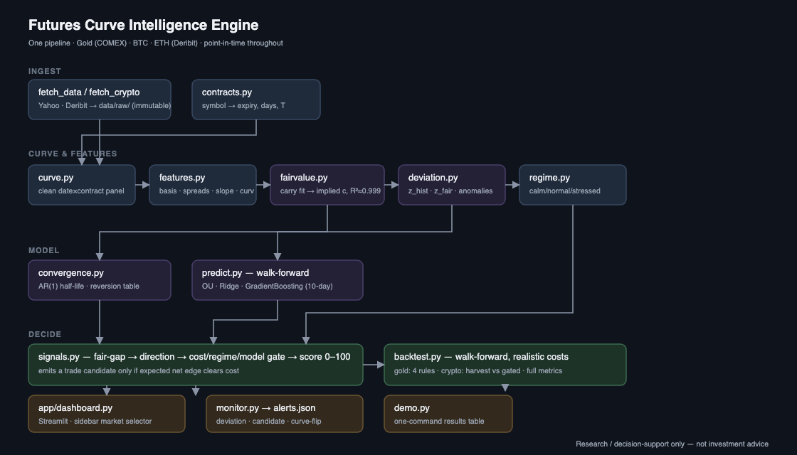

# Futures Curve Intelligence Engine

**One engine that reconstructs a futures curve, prices it from first principles, finds where the market disagrees, and backtests the trade — across Gold, BTC and ETH.**

> Research / decision-support only. **Not investment advice.** All results are in-sample, ~1 year, tens of trades — directional evidence, not a track record.

---

## The problem

A futures curve encodes what the market charges to hold an asset through time — financing, storage, dividends, scarcity, crypto funding. Most "signals" people trade off it are noise: two contracts being *close* is not an opportunity. The real question is:

> **Given maturity, carry, regime, liquidity and history — is today's curve materially different from its fair shape, and does the edge survive costs?**

This project answers that question end to end, and is honest when the answer is *no*.

## What it does



- **Fair value** — fits `ln F = a + c·T` across the whole curve each day; `c` is the implied carry rate. Gold fit R² ≈ 0.999.
- **Two deviations** — `z_hist` (vs the spread's own history) and `z_fair` (vs the carry curve). The second is the real signal; the first flags false anomalies when rates genuinely move.
- **Regime** — calm / normal / stressed (point-in-time vol percentile), trend, and crypto funding regime. Signals are down-weighted where mean-reversion is unreliable.
- **Prediction** — walk-forward OU / Ridge / Gradient-Boosting forecast of the next 10-day spread move. Only GBR showed out-of-sample skill (hit 0.54), used as a weak tilt.
- **Cost model** — tick-size / liquidity-tier for gold, ~4 bps/leg for crypto. Nothing becomes a *trade candidate* unless expected net edge clears cost.
- **Backtest** — event-driven, walk-forward, point-in-time, realistic costs, full metrics.

## Quickstart

```bash
pip install -r requirements.txt      # or:  make setup

python demo.py                       # runs gold + crypto, prints the results table
python -m streamlit run app/dashboard.py   # interactive dashboard (sidebar: Gold / BTC / ETH)
```

Individual pieces: `make gold`, `make crypto`, `make monitor`, `make test`.
After the first run, add `--skip-fetch` (or `make gold-fast`) to reuse cached data.

## Headline results

Walk-forward backtest, per $50k book, ~1 year, **in-sample**:

### Gold — four entry rules (proving the discipline layer)

| Strategy | Trades | Win % | P&L | Profit factor | Sharpe |
|----------|--------|-------|-----|---------------|--------|
| A — naive `z_hist` fade | 37 | 22 % | −$4,140 | 0.19 | −2.17 |
| B — fair-value fade | 24 | 33 % | −$1,810 | 0.36 | −2.18 |
| **C — gated (full discipline)** | 15 | 47 % | **−$580** | 0.60 | −0.77 |
| D — trade *with* the GBR forecast | 63 | 32 % | −$4,140 | 0.29 | −1.54 |

Gold's curve is efficiently priced — residual mispricings (~2 pts) don't clear costs (~1.1 pts). **The engine says STAND ASIDE**, and the backtest proves why: naive fading loses **7× more** than the disciplined version. The value here is rigorous measurement and capital protection.

### BTC & ETH — harvest vs gated (proving the signal, not the roll-down)

| Market · strategy | Trades | Win % | P&L | Profit factor | Sharpe | Max DD |
|-------------------|--------|-------|-----|---------------|--------|--------|
| BTC · harvest every contango basis | 187 | 29 % | −$8,844 | 0.75 | −0.80 | −$15,633 |
| **BTC · gated (`z_gap ≥ 1.25`)** | 29 | 65 % | **+$7,058** | 1.68 | 0.84 | −$7,115 |
| ETH · harvest | 165 | 35 % | −$37 | 0.97 | −0.09 | −$570 |
| ETH · gated | 33 | 64 % | +$349 | 2.26 | 1.15 | −$230 |

Blindly harvesting the basis **loses** (fees + funding + getting run over). Entering only when a dated future is *statistically rich versus funding* turns BTC positive (**+14 % / $50k, Sharpe 0.84**). ETH's curve barely dislocates, so the engine correctly finds almost nothing.

**Blended gated CAGR across the three markets ≈ +4 %** — carried entirely by the single BTC year. Treat as a hypothesis to validate, not a return.

## Repo layout

```
├── demo.py                  one-command reproducible demo
├── Makefile                 setup / gold / crypto / demo / dashboard / test / pdf
├── src/
│   ├── _paths.py            repo-root-anchored paths
│   ├── contracts.py         §8  symbol → underlying / expiry / days-to-expiry / T
│   ├── fetch_data.py        §7  Yahoo → immutable data/raw/
│   ├── curve.py             §9  clean + assemble the date×contract panel
│   ├── features.py          §10 basis, calendar spreads, slope, curvature
│   ├── fairvalue.py         §12 cost-of-carry fit → implied carry, fair curve
│   ├── deviation.py         §11 point-in-time z_hist / z_fair / anomaly flags
│   ├── regime.py            §17 calm/normal/stressed + trend + cluster
│   ├── convergence.py       §27,§29 AR(1) half-life + empirical reversion table
│   ├── predict.py           §14,§16 walk-forward OU / Ridge / GradientBoosting
│   ├── signals.py           §18,§19 fair-gap → cost/regime/model gate → score
│   ├── backtest.py          §20 event backtest, 4 strategies, full metrics
│   ├── pipeline.py          runs the whole gold chain (~3 s)
│   ├── monitor.py           §22 deviation / candidate / curve-flip alerts
│   ├── crypto_pipeline.py   BTC + ETH
│   └── crypto/
│       ├── fetch_crypto.py  Deribit adapter (perp + dated + index + funding)
│       └── engine.py        qbasis vs funding-fair value → z-score → backtest
├── app/dashboard.py         Streamlit product view (sidebar market selector)
├── scripts/probe_data.py    data-source probe
├── tests/test_pipeline.py   invariants incl. a no-look-ahead check
└── docs/
    ├── EXPLAINER.pdf         26-page explainer — every term, how it's used, is it profitable
    ├── ARCHITECTURE.md       design decisions & data-flow
    ├── SUBMISSION.md         hackathon writeup
    └── blueprint.md          the original spec this was built from
```

## Documentation

- **[docs/EXPLAINER.pdf](docs/EXPLAINER.pdf)** — the complete explainer: every term defined in plain language, how the engine uses it, and a profitability verdict per market. Start here.
- **[docs/ARCHITECTURE.md](docs/ARCHITECTURE.md)** — pipeline design, data-flow, key decisions, extension guide.
- **[docs/SUBMISSION.md](docs/SUBMISSION.md)** — inspiration, what I built, challenges, lessons, what's next.

## Honest limitations

- Free data only: gold has no true cash feed (nearest contract is the anchor), no open interest; crypto history is ~1 year and one funding regime.
- 15–40 trades per backtest — a positive Sharpe here is **not** statistically significant.
- Costs are modelled from tick size / fee schedules, not live bid-ask.
- Nothing has been paper-traded or run forward.

## License

MIT — see [LICENSE](LICENSE). Not investment advice; trading futures carries substantial risk of loss.
